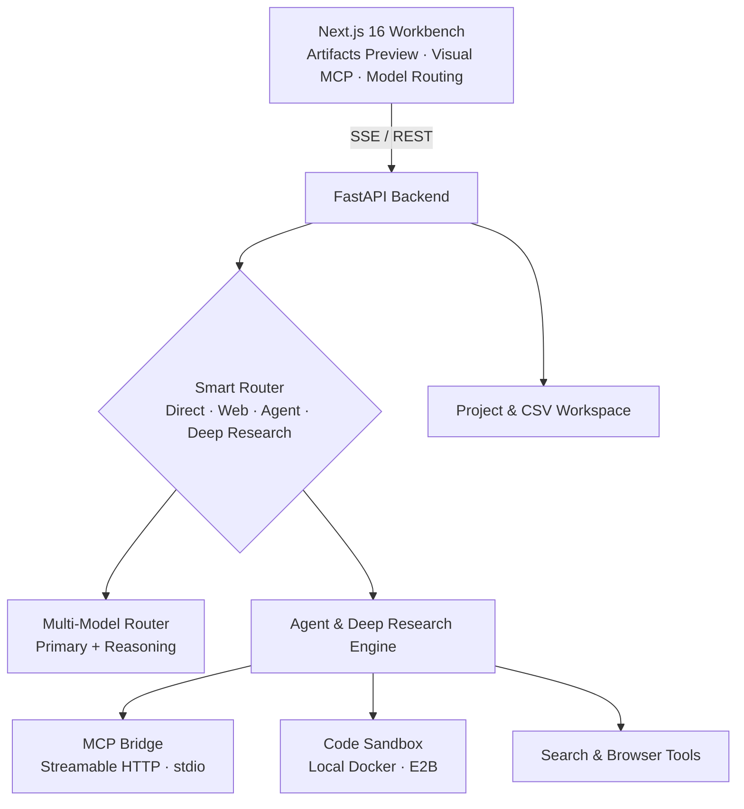

<div align="right">
  <strong>简体中文</strong> |
  <a href="docs/README.en.md">English</a>
</div>

<div align="center">


# Weaver

**开源 AI Agent 工作台 —— 深度研究 · 可视化 MCP 生态 · 本地免费 Docker 沙盒 · 交互式产物预览**


[快速开始](#快速开始) · [本地 Docker 沙盒](#可选启用本地免费-docker-沙盒) · [MCP 集成](docs/mcp.md) · [配置说明](docs/configuration.md) · [文档中心](docs/README.md)


</div>

---

## 为什么选择 Weaver

- **可视化 MCP 工具生态（Model Context Protocol）**
  原生支持现代 `Streamable HTTP`（含自定义请求头）与 `stdio`（含环境变量/工作目录）传输，配置持久化至 `config/mcp.json`。在 Web 设置页即可可视化地增删启停、查看实时工具列表、一键导入 Claude Desktop / Cursor 标准 `mcpServers` JSON，并在聊天输入框按需开关。
- **双沙盒代码执行（本地免费 Docker + E2B 云端）**
  不买 E2B Key 也能跑代码与分析数据。内置**本地免费 Docker 沙盒（默认关闭，按需开启）**，与 E2B 共享同一套 `execute_python_code` / `sandbox_files` / `sandbox_shell` 工具接口；容器默认断网（`--network none`）、降权运行、限制 CPU/内存/进程数、按线程挂载独立 `/workspace` 并在退出时自动回收。
- **交互式产物预览与执行视图（Artifacts & Console）**
  右侧产物侧栏在严格沙盒 `<iframe>`（CSP 隔离）中直接渲染模型生成的交互式 HTML 报告、图表与 SVG，支持「预览 / 代码」切换、重载、复制与全屏查看；工具执行输出自动归类为可折叠等宽终端视图。
- **通用多模型接入 + 双角色路由**
  自动拉取 **SiliconFlow（硅基流动）** 以及任意 OpenAI 兼容网关（DeepSeek、OpenRouter、OneAPI、Ollama、vLLM）的 `/v1/models` 目录，同时支持 Anthropic。前端支持按场景独立配置**主力对话模型**与**深度推理模型**，兼顾响应速度与复杂任务质量。
- **Deep Research 深度研究 & 持久化工作区（`/workspace`）**
  支持直答、联网检索、Agent 工具执行与多轮深度研究四种模式，思考与检索步骤清晰折叠呈现并附带来源核对；内置项目工作区与 **CSV 智能分析台**，支持关闭页面后后台续跑并导出 Markdown 报告与 SVG 图表。
- **精致的现代工作台体验**
  Next.js 16 + React 19，原生支持浅色/深色主题、中/英/日/韩四语种界面、侧栏宽屏专注模式（`Ctrl/Cmd + B`）与流式 SSE 实时交互。

---

## 架构概览



> 完整架构与 LangGraph 工作流说明见 [`docs/architecture.md`](docs/architecture.md)

---

## 快速开始

### 1. 克隆并配置 `.env`

```bash
git clone https://github.com/skygazer42/Weaver.git
cd Weaver

cp .env.example .env
cp web/.env.local.example web/.env.local
```

编辑根目录 `.env`，填入任意 1 个模型密钥即可启动（开启联网与深度研究推荐补上 `TAVILY_API_KEY`）：

```env
# 方式 A：硅基流动（开箱自动拉取模型目录）
SILICONFLOW_API_KEY=sk-...

# 或方式 B：DeepSeek / OpenRouter / OneAPI / Ollama 等任意 OpenAI 兼容网关
# OPENAI_API_KEY=sk-...
# OPENAI_BASE_URL=https://api.deepseek.com/v1

# 推荐：联网检索与 Deep Research
TAVILY_API_KEY=tvly-...
```

### 2. 安装依赖并启动

```bash
# 安装后端依赖（Python 3.11+）与前端依赖（Node.js 20+ / pnpm）
make setup
pnpm -C web install --frozen-lockfile

# 终端 1：启动后端（macOS / Linux）
.venv/bin/python main.py
# Windows PowerShell：.\.venv\Scripts\python.exe main.py

# 终端 2：启动前端
pnpm -C web dev
```

打开浏览器访问：

- **Web 工作台**：`http://localhost:3100`
- **项目与 CSV 工作区**：`http://localhost:3100/workspace`
- **后端 API / OpenAPI**：`http://localhost:8001/docs`

---

## 按需扩展能力

### （可选）接入 MCP 外部工具

无需手写环境变量，启动后直接打开 Web 左下角 **设置 → MCP 服务器**：

- 可视化添加 `Streamable HTTP`（远程 URL + Header）或 `stdio`（本地命令 + 参数 + 环境变量）服务；
- 支持一键粘贴导入 Claude Desktop / Cursor 标准 `mcpServers` JSON；
- 配置自动持久化到 `config/mcp.json`，并可在聊天输入框的 MCP 开关中实时查看可用工具与状态。

详细说明见 [`docs/mcp.md`](docs/mcp.md)。

### （可选）启用本地免费 Docker 沙盒

> 默认关闭（`ENABLE_DOCKER_SANDBOX=false`），未配置 `E2B_API_KEY` 时可按需开启。

1. 启动本机 **Docker Desktop**（Windows / macOS）或 **Docker Engine**（Linux），确认服务就绪并拉取镜像：

```bash
docker info
docker pull python:3.12-slim
```

> 如需在断网容器内直接做 CSV 分析与画图，可将 `DOCKER_SANDBOX_IMAGE` 替换为预装 `pandas`、`numpy`、`matplotlib` 的自定义镜像。

2. 在根目录 `.env` 中开启配置并重启后端：

```env
ENABLE_DOCKER_SANDBOX=true
DOCKER_SANDBOX_IMAGE=python:3.12-slim
DOCKER_SANDBOX_CPUS=1.0
DOCKER_SANDBOX_MEMORY=512m
DOCKER_SANDBOX_NETWORK_ENABLED=false
```

容器默认启用 `--network none`、`--cap-drop ALL`、`--security-opt no-new-privileges` 与进程数限制，按对话线程挂载独立 `/workspace`，服务退出时自动回收。更多参数见 [`docs/configuration.md`](docs/configuration.md)。

---

## 常用开发命令

```bash
# 后端测试与代码检查
make test && make lint

# 前端测试、Lint、类型检查与构建
pnpm -C web test
pnpm -C web lint
pnpm -C web exec tsc --noEmit
pnpm -C web build
```

---

## 文档导航

| 文档 | 说明 |
|------|------|
| [快速开始](docs/getting-started.md) | 完整安装步骤、CSV 工作台与常见问题 |
| [配置说明](docs/configuration.md) | 模型网关、本地 Docker / E2B 沙盒与高阶环境变量 |
| [MCP 集成](docs/mcp.md) | Streamable HTTP / stdio 接入示例与安全实践 |
| [系统架构](docs/architecture.md) | 核心模块与 LangGraph 执行流说明 |
| [部署与加固](docs/deployment.md) | Docker Compose、反代鉴权、限流与 SSE 配置 |
| [全部文档索引](docs/README.md) | API、流式协议、开发指南、Benchmarks 与路线图 |

---

## 贡献与开源协议

- 贡献指南：[`CONTRIBUTING.md`](CONTRIBUTING.md) · 安全说明：[`SECURITY.md`](SECURITY.md) · 行为准则：[`CODE_OF_CONDUCT.md`](CODE_OF_CONDUCT.md)
- 本项目基于 **MIT License** 开源，详见 [`LICENSE`](LICENSE)。
