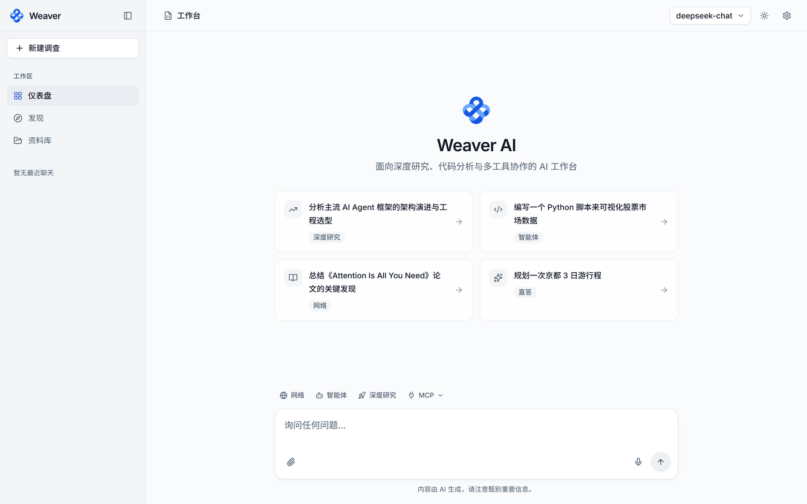
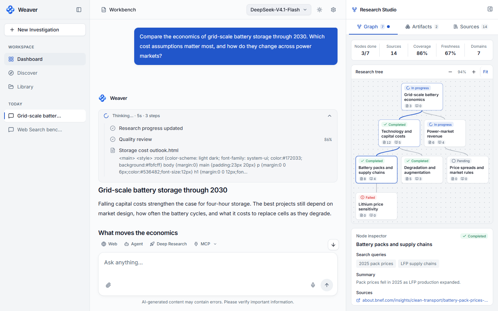
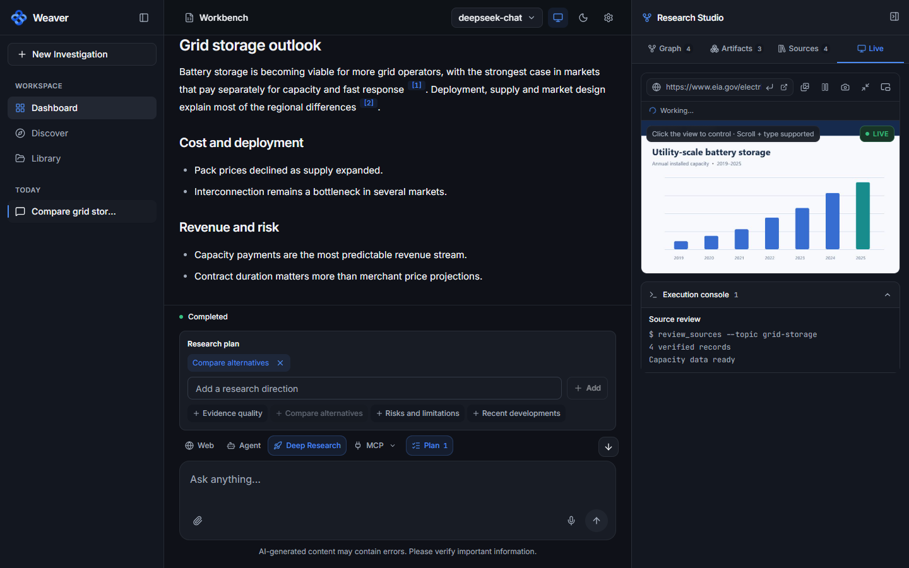
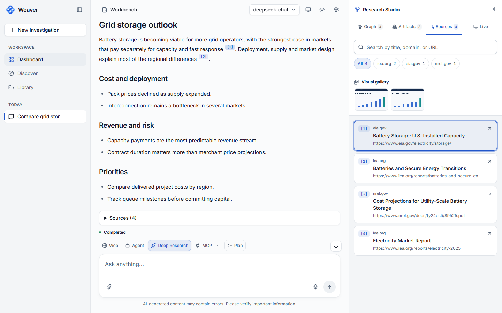
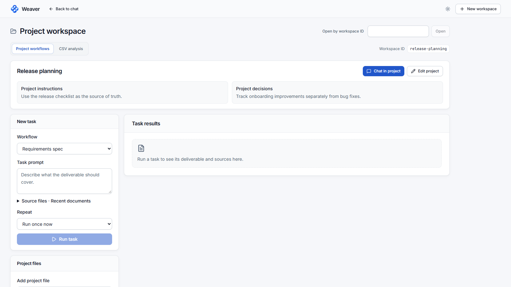
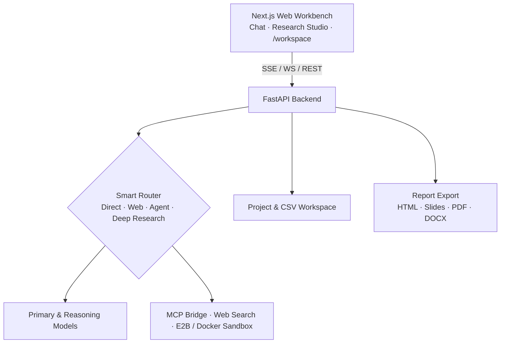

<div align="right">
  <strong>简体中文</strong> |
  <a href="docs/README.en.md">English</a>
</div>

<div align="center">


# Weaver

**开源 AI Agent 工作台 —— 深度研究 · Research Studio · 可视化 MCP · 多模型路由 · 沙盒执行**


[核心特性](#核心特性) · [界面预览](#界面预览) · [快速开始](#快速开始) · [MCP 集成](docs/mcp.md) · [配置说明](docs/configuration.md) · [文档中心](docs/README.md)



</div>

---

## 核心特性

- **多模式深度研究与研究计划**：支持直答、联网检索、Agent 执行与多轮 Deep Research；深度研究前可在输入框旁展开轻量 **Plan** 面板自定义研究方向，检索过程自动折叠、结论附带可验证引用。
- **Research Studio 四合一分屏工作台**：
  - **研究图谱 & 结论思维导图（Graph）**：实时生长的交互式研究树与质量遥测，点击节点即可查看检索词、摘要与来源；一键切换 Markdown 结论思维导图并导出 **SVG / PNG**。
  - **交互式产物与多格式报告导出（Artifacts）**：安全沙盒预览 HTML 报告、SVG 图表与代码；报告支持一键导出 **Markdown / HTML / 交互式 Slides（含全屏翻页预览）/ PDF / Word（`.docx`）**。
  - **引用联动与视觉图库（Sources）**：正文内联 `[1]` 悬停溯源、点击自动定位高亮右侧来源卡片，支持按域名与关键词筛选及截图/图表灯箱预览。
  - **Agent 实时电脑停靠栏（Live）**：右侧直接停靠实时浏览器视图与可折叠执行终端，支持「右侧停靠 ↔ 左下角悬浮小电视」一键切换。
- **双引擎安全沙盒（E2B / 本地 Docker）**：支持 E2B 云端沙盒（Python 代码执行、实时浏览器与桌面自动化），也支持按需开启免费隔离的本地 Docker 沙盒。
- **可视化 MCP 工具生态**：在 Web 设置页管理 `Streamable HTTP` / `stdio` 工具服务，支持一键导入 Claude Desktop / Cursor 配置并在聊天输入框按需开关。
- **多模型自动发现与双角色路由**：开箱支持硅基流动、DeepSeek、OpenRouter、Ollama、vLLM、Anthropic 与任意 OpenAI 兼容网关，可分别指定主力模型与深度推理模型。
- **持久化工作区（`/workspace`）**：统一管理项目上下文、共享文件与定时任务，内置 CSV 智能分析台，支持后台续跑并导出报告与图表。

---

## 界面预览

<table>
  <tr>
    <td width="50%">
      
      <p align="center"><sub><b>实时研究图谱（Graph）</b>：交互式研究树、质量遥测与节点详情检视</sub></p>
    </td>
    <td width="50%">
      
      <p align="center"><sub><b>实时电脑停靠栏（Live）&amp; 研究计划</b>：深色主题下的浏览器视图与执行终端</sub></p>
    </td>
  </tr>
  <tr>
    <td width="50%">
      
      <p align="center"><sub><b>引用联动与视觉图库（Sources）</b>：正文 <code>[1]</code> 跳转高亮、域名筛选与图表灯箱</sub></p>
    </td>
    <td width="50%">
      
      <p align="center"><sub><b>持久化工作区（/workspace）</b>：项目上下文、文件管理、任务流与 CSV 分析台</sub></p>
    </td>
  </tr>
</table>

---

## 架构概览



> 完整架构说明见 [`docs/architecture.md`](docs/architecture.md)

---

## 快速开始

### 1. 克隆并准备配置

```bash
git clone https://github.com/skygazer42/Weaver.git
cd Weaver

cp .env.example .env
cp web/.env.local.example web/.env.local
```

在根目录 `.env` 中填入任意 1 个模型密钥即可启动：

```env
# 硅基流动
SILICONFLOW_API_KEY=sk-...

# DeepSeek / OpenRouter / Ollama 等 OpenAI 兼容网关
# OPENAI_API_KEY=sk-...
# OPENAI_BASE_URL=https://api.deepseek.com/v1

# 联网与 Deep Research
TAVILY_API_KEY=tvly-...
```

### 2. 安装依赖并启动

```bash
# 安装前后端依赖（Python 3.11+、Node.js 20+、pnpm）
make setup
pnpm -C web install --frozen-lockfile

# 终端 1：启动后端（Windows PowerShell 请使用 .\.venv\Scripts\python.exe main.py）
.venv/bin/python main.py

# 终端 2：启动前端
pnpm -C web dev
```

访问地址：

- **Web 工作台**：`http://localhost:3100`
- **项目工作区**：`http://localhost:3100/workspace`
- **API 文档**：`http://localhost:8001/docs`

> - 启动后可在 Web 设置页 **MCP 服务器** 直接添加或导入 MCP 工具；
> - 报告导出默认内置 Markdown / HTML / 交互式 Slides / Word（`python-docx`），PDF 优先使用 WeasyPrint，在 Windows 无 GTK 环境下自动回退本机 Chrome / Edge 无头排版；
> - 按需开启 E2B 云端沙盒或免费本地 Docker 沙盒等高阶参数，详见 [`docs/configuration.md`](docs/configuration.md)。

---

## 常用开发命令

```bash
# 后端测试与代码检查
make test && make lint

# 前端测试、Lint、类型检查与构建
pnpm -C web test && pnpm -C web lint && pnpm -C web exec tsc --noEmit && pnpm -C web build
```

---

## 文档导航

| 文档 | 说明 |
|------|------|
| [快速开始](docs/getting-started.md) | 完整本地安装、CSV 工作台与常见问题 |
| [配置说明](docs/configuration.md) | 模型网关、E2B / 本地 Docker 沙盒与高阶参数 |
| [MCP 集成](docs/mcp.md) | MCP 工具接入示例与安全建议 |
| [系统架构](docs/architecture.md) | 核心模块与工作流说明 |
| [部署与加固](docs/deployment.md) | Docker Compose、反代鉴权与限流 |
| [全部文档](docs/README.md) | API、流式协议、开发指南与路线图 |

---

## 开源协议

- 贡献指南：[`CONTRIBUTING.md`](CONTRIBUTING.md) · 安全说明：[`SECURITY.md`](SECURITY.md)
- 本项目基于 **MIT License** 开源，详见 [`LICENSE`](LICENSE)。
