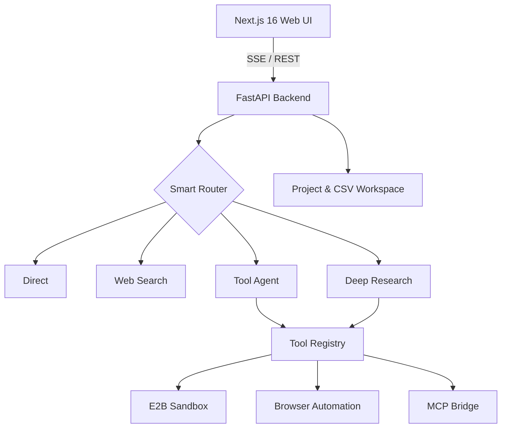

<div align="right">
  <strong>简体中文</strong> |
  <a href="docs/README.en.md">English</a>
</div>

<div align="center">


# Weaver

**面向深度研究、代码分析与多工具协作的开源 AI 智能体工作台**


[文档中心](docs/README.md) · [配置说明](docs/configuration.md) · [问题反馈](https://github.com/skygazer42/Weaver/issues) · [讨论区](https://github.com/skygazer42/Weaver/discussions)


</div>

---

## 核心能力

- **四种模式与智能路由**：支持直答（Direct）、联网检索（Web）、智能体（Agent）与深度研究（Deep Research），自动或按需切换执行策略。
- **Deep Research 深度研究**：并行检索 + 多轮迭代 + 证据校验与引用溯源，思考与检索过程以清晰的用户视角步骤折叠展示。
- **项目工作区（`/workspace`）**：集中管理项目上下文、共享文件与持久化工作流，内置 **CSV 智能分析台**（沙箱分析并导出 Markdown 报告与 SVG 图表）。
- **多模型与网关适配**：开箱支持 **SiliconFlow（硅基流动）**、DeepSeek、OpenAI 兼容网关及 Anthropic，前端自动拉取后端允许列表并按厂商分组搜索。
- **沙箱、浏览器与 MCP 生态**：集成 E2B 代码沙箱、Playwright 浏览器自动化、可选语音识别/合成，并支持通过 **MCP（Model Context Protocol）** 扩展外部工具。
- **企业级研究工作台 UI**：Next.js 16 + React 19 + Tailwind CSS，支持浅色/深色主题、中/英/日/韩四语言、宽屏专注模式（`Ctrl/Cmd + B`）与流式 SSE 产物侧栏。

---

## 架构概览

> 完整架构与工作流说明见 [`docs/architecture.md`](docs/architecture.md)



---

## 快速开始（2 分钟跑起来）

> 完整安装、E2B / Playwright / MCP 与 Docker Compose 部署步骤见 [`docs/getting-started.md`](docs/getting-started.md)

### 1. 克隆并准备环境变量

```bash
git clone https://github.com/skygazer42/Weaver.git
cd Weaver

cp .env.example .env
cp web/.env.local.example web/.env.local
```

编辑根目录 `.env`，**最少只需填写 1 个模型密钥**（联网搜索与深搜推荐补上 `TAVILY_API_KEY`）：

```env
# 方式 A：硅基流动（推荐，填 Key 即可用，默认 deepseek-ai/DeepSeek-V4.1-Flash）
SILICONFLOW_API_KEY=sk-...

# 或方式 B：OpenAI / DeepSeek 等兼容网关
# OPENAI_API_KEY=sk-...
# OPENAI_BASE_URL=https://api.deepseek.com/v1

# 推荐：联网搜索与 Deep Research
TAVILY_API_KEY=tvly-...
```

> 根目录 `.env.example` 已精简为起步常用项；其余高阶参数均带内置默认值，完整说明见 [`docs/configuration.md`](docs/configuration.md)。

### 2. 安装依赖

```bash
# 后端依赖（创建 .venv）
make setup

# 前端依赖（需 Node.js 20+ 与 pnpm）
pnpm -C web install --frozen-lockfile
```

### 3. 启动服务

```bash
# 终端 1：启动 FastAPI 后端（macOS / Linux）
.venv/bin/python main.py
# Windows PowerShell：
# .\.venv\Scripts\python.exe main.py

# 终端 2：启动 Next.js 前端（默认 3100 端口）
pnpm -C web dev
```

启动后访问：

- **Web 工作台**：`http://localhost:3100`
- **项目工作区**：`http://localhost:3100/workspace`
- **后端 API**：`http://localhost:8001`（OpenAPI 文档：`http://localhost:8001/docs`）

---

## 常用开发命令

```bash
# 后端测试与代码检查
make test
make lint

# 前端单元测试、Lint 与类型检查
pnpm -C web test
pnpm -C web lint
pnpm -C web exec tsc --noEmit
```

---

## 文档导航

| 文档 | 说明 |
|------|------|
| [快速开始](docs/getting-started.md) | 本地运行、依赖安装、常见问题 |
| [配置说明](docs/configuration.md) | `.env` / `web/.env.local` / 高阶环境变量速查 / Agent / MCP |
| [系统架构](docs/architecture.md) | 架构图与 LangGraph 工作流说明 |
| [使用指南](docs/usage.md) | 模式选择、Deep Research、代码执行、浏览器自动化 |
| [MCP 集成](docs/mcp.md) | MCP servers 配置示例与安全建议 |
| [部署与加固](docs/deployment.md) | Docker/Compose、反代鉴权、限流与 SSE 注意事项 |
| [开发指南](docs/development.md) | 本地脚本、测试、Lint 与日志 |
| [API 说明](docs/api.md) | OpenAPI 合约、常用端点与 SSE 调用示例 |
| [流式协议](docs/chat-streaming.md) | SSE / legacy 协议细节与回滚策略 |
| [OpenAPI 合约对齐](docs/openapi-contract.md) | 后端 ↔ 前端 TypeScript 类型自动生成 |
| [Benchmarks](docs/benchmarks/README.md) | Deep Research 评测与样例集 |
| [路线图](docs/roadmap.md) | 规划与演进方向 |

---

## 贡献与开源协议

- 贡献指南：[`CONTRIBUTING.md`](CONTRIBUTING.md) · 安全说明：[`SECURITY.md`](SECURITY.md) · 行为准则：[`CODE_OF_CONDUCT.md`](CODE_OF_CONDUCT.md)
- 本项目基于 **MIT License** 开源，详见 [`LICENSE`](LICENSE)。
