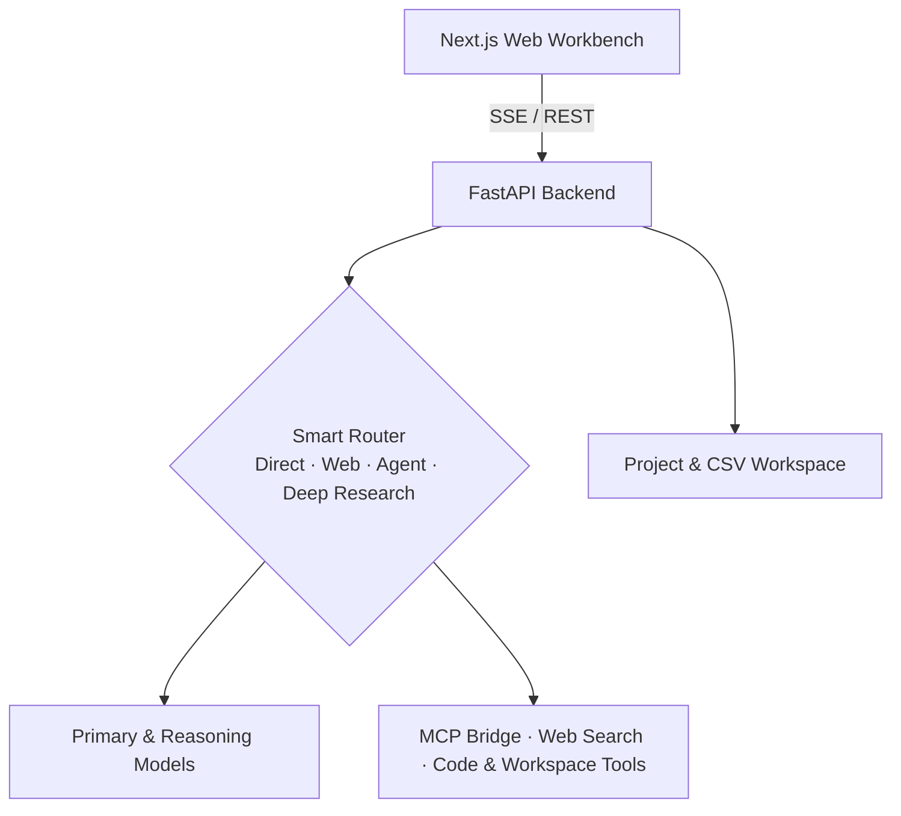

<div align="right">
  <strong>简体中文</strong> |
  <a href="docs/README.en.md">English</a>
</div>

<div align="center">


# Weaver

**开源 AI Agent 工作台 —— 深度研究 · 可视化 MCP · 多模型路由 · 交互式产物预览**


[快速开始](#快速开始) · [MCP 集成](docs/mcp.md) · [配置说明](docs/configuration.md) · [文档中心](docs/README.md)


</div>

---

## 核心特性

- **深度研究与智能体模式**：支持直答、联网检索、Agent 执行与多轮 Deep Research，检索过程清晰折叠、结论附带来源引用。
- **可视化 MCP 工具生态**：在 Web 设置页管理 `Streamable HTTP` / `stdio` 工具服务，一键导入 Claude Desktop / Cursor 配置，并在聊天输入框按需开关。
- **交互式产物预览**：右侧侧栏直接渲染模型生成的 HTML 报告、SVG 图表与代码，支持预览 / 代码切换与全屏查看。
- **多模型自由接入与双角色路由**：开箱支持硅基流动、DeepSeek、OpenRouter、Ollama、vLLM 与 Anthropic，可分别指定主力模型与深度推理模型。
- **持久化工作区（`/workspace`）**：集中管理项目上下文与文件，内置 CSV 智能分析台，支持后台续跑并导出报告与图表。
- **开箱即用的现代界面**：支持浅色 / 深色主题、中英日韩四语种与宽屏专注模式。

---

## 架构概览



> 完整架构说明见 [`docs/architecture.md`](docs/architecture.md)

---

## 快速开始

### 1. 克隆并准备配置

```bash
git clone https://github.com/skygazer42/Weaver.git
cd Weaver

cp .env.example .env
cp web/.env.local.example web/.env.local
```

在根目录 `.env` 中填入任意 1 个模型密钥即可启动（联网检索与深度研究推荐补上 `TAVILY_API_KEY`）：

```env
# 硅基流动（推荐，填 Key 即用）
SILICONFLOW_API_KEY=sk-...

# 或任意 OpenAI 兼容网关（DeepSeek / OpenRouter / Ollama 等）
# OPENAI_API_KEY=sk-...
# OPENAI_BASE_URL=https://api.deepseek.com/v1

# 推荐：联网与 Deep Research
TAVILY_API_KEY=tvly-...
```

### 2. 安装依赖并启动

```bash
# 安装前后端依赖（Python 3.11+、Node.js 20+、pnpm）
make setup
pnpm -C web install --frozen-lockfile

# 终端 1：启动后端（Windows PowerShell 请使用 .\.venv\Scripts\python.exe main.py）
.venv/bin/python main.py

# 终端 2：启动前端
pnpm -C web dev
```

访问地址：

- **Web 工作台**：`http://localhost:3100`
- **项目工作区**：`http://localhost:3100/workspace`
- **API 文档**：`http://localhost:8001/docs`

> 启动后可在 Web 左下角 **设置 → MCP 服务器** 直接添加或导入 MCP 工具；如需按需开启代码执行环境或其他高阶参数，详见 [`docs/configuration.md`](docs/configuration.md)。

---

## 常用开发命令

```bash
make test && make lint
pnpm -C web test && pnpm -C web lint && pnpm -C web exec tsc --noEmit
```

---

## 文档导航

| 文档 | 说明 |
|------|------|
| [快速开始](docs/getting-started.md) | 完整本地安装、CSV 工作台与常见问题 |
| [配置说明](docs/configuration.md) | 模型网关、可选代码执行环境（E2B / 本地 Docker）与高阶参数 |
| [MCP 集成](docs/mcp.md) | MCP 工具接入示例与安全建议 |
| [系统架构](docs/architecture.md) | 核心模块与工作流说明 |
| [部署与加固](docs/deployment.md) | Docker Compose、反代鉴权与限流 |
| [全部文档](docs/README.md) | API、流式协议、开发指南与路线图 |

---

## 开源协议

- 贡献指南：[`CONTRIBUTING.md`](CONTRIBUTING.md) · 安全说明：[`SECURITY.md`](SECURITY.md)
- 本项目基于 **MIT License** 开源，详见 [`LICENSE`](LICENSE)。
