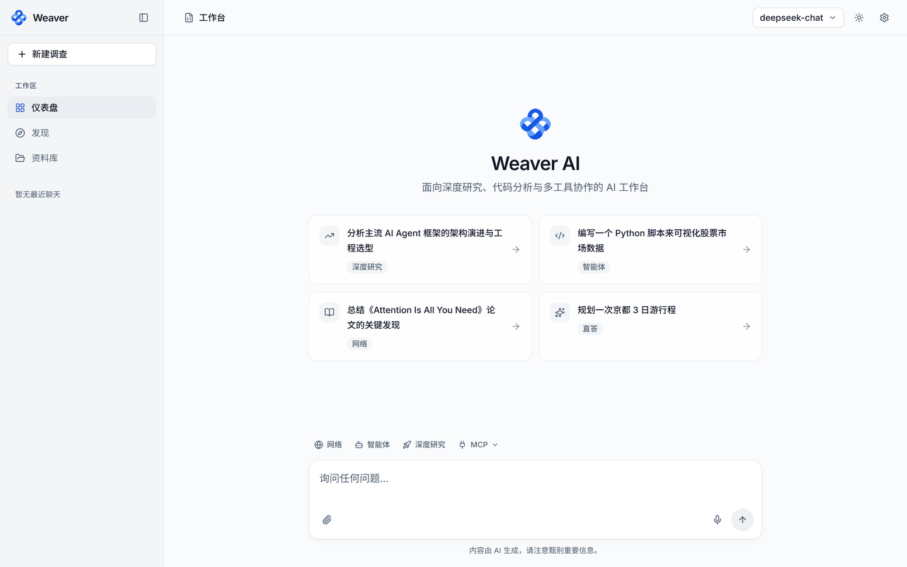
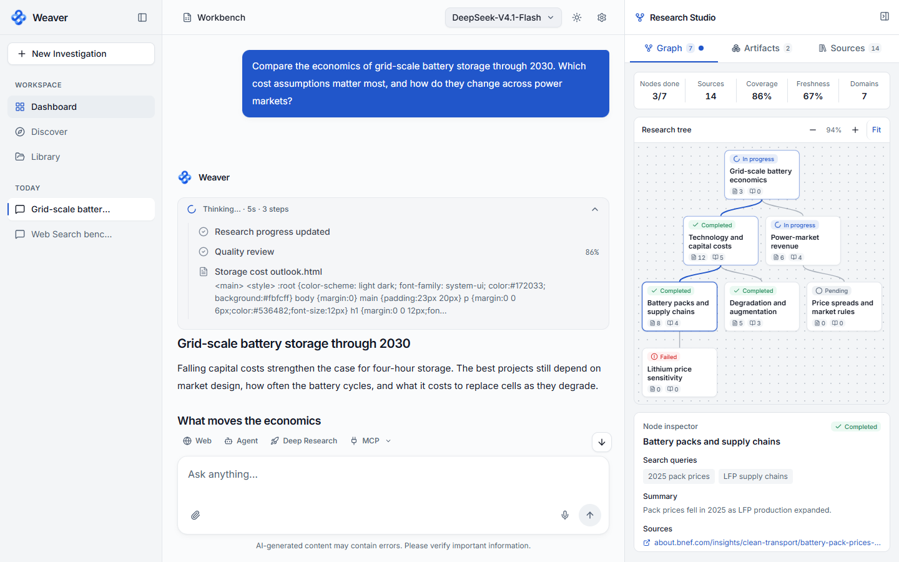
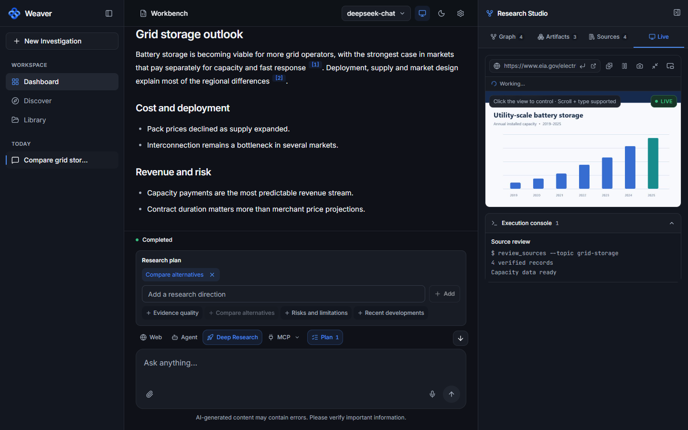
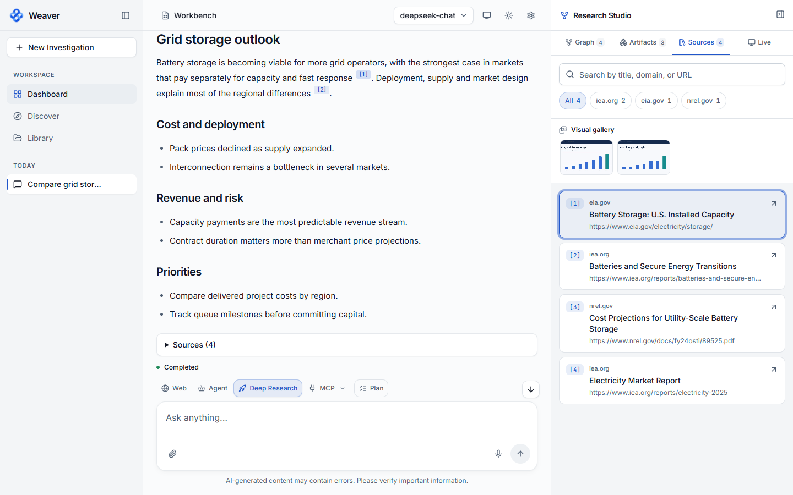
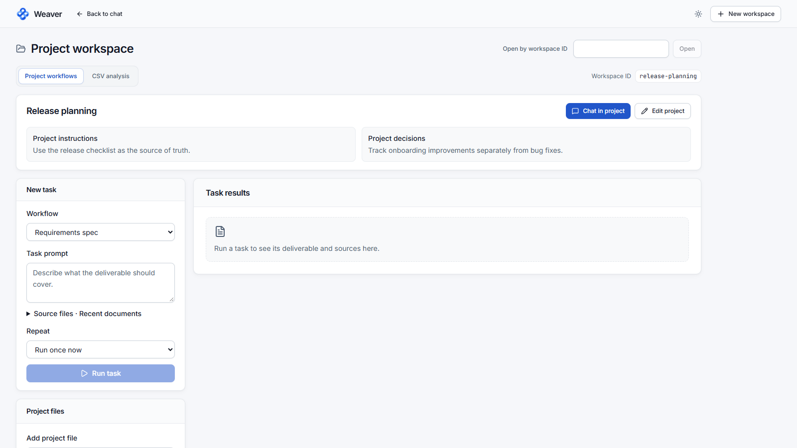
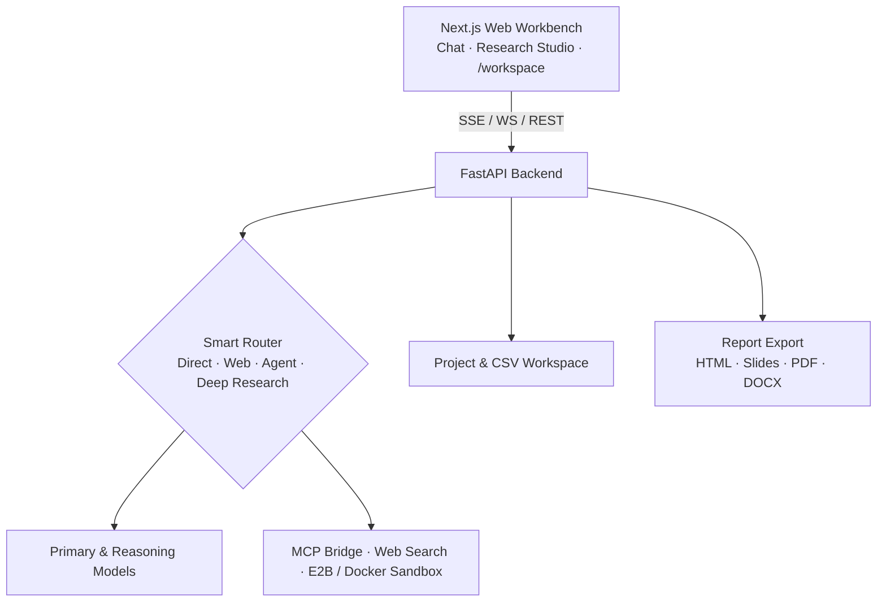

<div align="right">
  <strong>English</strong> |
  <a href="../README.md">简体中文</a>
</div>

<div align="center">


# Weaver

**Open-source AI Agent Workbench — Deep Research · Research Studio · Visual MCP · Multi-Model Routing · Sandbox Execution**


[Key Features](#key-features) · [Screenshots](#screenshots) · [Quick Start](#quick-start) · [MCP Guide](./mcp.md) · [Configuration](./configuration.md) · [Docs](./README.md)



</div>

---

## Key Features

- **Multi-Mode Deep Research & Research Plans**: Direct, Web, Agent, and iterative Deep Research modes with an optional **Plan** editor beside the composer, clean collapsible progress summaries, and verifiable citations.
- **Research Studio Split Workbench**:
  - **Live Research Graph & Report Mind Map (`Graph`)**: Interactive research tree that grows live during exploration with node inspection and quality telemetry; one-click toggle to a Markdown conclusion mind map with **SVG / PNG** export.
  - **Interactive Artifacts & Multi-Format Export (`Artifacts`)**: Sandboxed preview for HTML reports, SVG charts, and code; one-click report export to **Markdown, HTML, Interactive Slides (with fullscreen preview), PDF, and Word (`.docx`)**.
  - **Linked Citations & Visual Gallery (`Sources`)**: Inline `[1]` citation hover cards and click-to-highlight source navigation, domain/keyword filtering, and a lightbox gallery for captured screenshots and charts.
  - **Docked Live Agent Computer (`Live`)**: Embedded live browser view and collapsible execution console with one-click **Dock ↔ Float** switching.
- **Dual-Engine Sandbox (`E2B` / Local Docker)**: Run Python code, browser automation, and desktop actions in E2B cloud sandboxes, or opt in to a free, isolated local Docker sandbox.
- **Visual MCP Ecosystem**: Manage `Streamable HTTP` and `stdio` servers in Web Settings, import Claude Desktop / Cursor configs in one click, and toggle tools directly in the chat composer.
- **Multi-Model Discovery & Dual-Role Routing**: Works out of the box with SiliconFlow, DeepSeek, OpenRouter, Ollama, vLLM, Anthropic, and any OpenAI-compatible gateway, with independent Primary and Reasoning model routing.
- **Persistent Workspaces (`/workspace`)**: Organize project context, shared files, and scheduled tasks, plus a built-in CSV analysis workbench with background execution and exportable reports and charts.

---

## Screenshots

<table>
  <tr>
    <td width="50%">
      
      <p align="center"><sub><b>Research Graph</b>: Live research tree, quality telemetry &amp; node inspector</sub></p>
    </td>
    <td width="50%">
      
      <p align="center"><sub><b>Docked Live Computer &amp; Research Plan</b>: Embedded live browser &amp; execution console</sub></p>
    </td>
  </tr>
  <tr>
    <td width="50%">
      
      <p align="center"><sub><b>Sources &amp; Visual Gallery</b>: Inline <code>[1]</code> linkage, domain filters &amp; chart lightbox</sub></p>
    </td>
    <td width="50%">
      
      <p align="center"><sub><b>Persistent Workspace (/workspace)</b>: Project context, files, workflows &amp; CSV workbench</sub></p>
    </td>
  </tr>
</table>

---

## Architecture Overview



> See [`docs/architecture.md`](./architecture.md) for the full architecture breakdown.

---

## Quick Start

### 1. Clone & Configure

```bash
git clone https://github.com/skygazer42/Weaver.git
cd Weaver

cp .env.example .env
cp web/.env.local.example web/.env.local
```

Add at least one model provider key to the root `.env`:

```env
# SiliconFlow
SILICONFLOW_API_KEY=sk-...

# DeepSeek / OpenRouter / Ollama or any OpenAI-compatible gateway
# OPENAI_API_KEY=sk-...
# OPENAI_BASE_URL=https://api.deepseek.com/v1

# Web search & Deep Research
TAVILY_API_KEY=tvly-...
```

### 2. Install & Run

```bash
# Install backend & frontend dependencies (Python 3.11+, Node.js 20+, pnpm)
make setup
pnpm -C web install --frozen-lockfile

# Terminal 1: Start backend (Windows PowerShell: .\.venv\Scripts\python.exe main.py)
.venv/bin/python main.py

# Terminal 2: Start frontend
pnpm -C web dev
```

Access points:

- **Web Workbench**: `http://localhost:3100`
- **Project Workspace**: `http://localhost:3100/workspace`
- **API Docs**: `http://localhost:8001/docs`

> - Manage or import MCP servers directly in **Settings → MCP Servers**;
> - Markdown, HTML, Interactive Slides, and Word (`.docx`) exports work out of the box; PDF export uses WeasyPrint and automatically falls back to local headless Chrome / Edge on Windows when GTK libraries are not installed;
> - To opt in to E2B cloud sandboxes, the free local Docker sandbox, or advanced tuning, see [`docs/configuration.md`](./configuration.md).

---

## Common Dev Commands

```bash
# Backend tests & lint
make test && make lint

# Frontend tests, lint, type check & build
pnpm -C web test && pnpm -C web lint && pnpm -C web exec tsc --noEmit && pnpm -C web build
```

---

## Documentation

| Document | Description |
|----------|-------------|
| [Getting Started](./getting-started.md) | Complete local installation, CSV workbench, and troubleshooting |
| [Configuration](./configuration.md) | Model gateways, E2B / local Docker sandbox, and advanced settings |
| [MCP Guide](./mcp.md) | MCP server integration examples and security recommendations |
| [Architecture](./architecture.md) | Core modules and LangGraph workflow overview |
| [Deployment](./deployment.md) | Docker Compose, reverse-proxy auth, and rate limiting |
| [All Docs](./README.md) | API reference, streaming protocol, developer guide, and roadmap |

---

## License

- Contributing: [`CONTRIBUTING.md`](../.github/CONTRIBUTING.md) · Security: [`SECURITY.md`](../.github/SECURITY.md)
- Released under the **MIT License** — see [`LICENSE`](../LICENSE).
