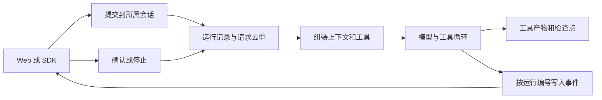

# Weaver Agent、上下文、工具与 E2E 升级 Spec

设计基线为 `a620ba0`，调研和硅基流动协议验证完成于 2026 年 11 月 23 日。验收范围从普通 Agent 聊天开始，覆盖工具调用、报告产物、用户审批和重连，并延伸到 Deep Research 与 Workbench 的回归。

## 目标与完成标准

- 用户在同一会话中连续追问或刷新页面时，Agent 能使用正确的前文、已确认的用户偏好和可读取的工具产物。
- 用户能够跟踪一次任务正在做什么、何时等待确认、何时失败以及如何停止。刷新后可以接回原运行，报告和工具状态按事件编号去重。
- 每个工具按当前运行的权限、配置和会话执行。一次主模型故障只能进入一次主模型错误处理。大工具结果可以按需展开，模型输入有可测的预算。
- 每项改动都有可重复的浏览器或 API 验收，并将硅基流动真模型兼容性结果独立记录。

## 仓库基线

| 路径 | 当前证据 | 升级影响 |
| --- | --- | --- |
| 聊天入口 | Web 提交完整 `messages`。普通和 SSE 入口只取最后一条用户消息，每次创建新的运行线程。两轮替身用例确认前文缺失。 | 把历史接入同一套组装逻辑，区分长期会话和单次运行。 [Web 请求](../../web/hooks/useChatStream.ts) · [API](../../main.py) |
| Agent 指令与记忆 | 记忆读取带用户 ID。完成时的记忆写入没有传该 ID，且报告正文和交互分别写入。注入任意 `SystemMessage` 时，Agent 默认指令会被跳过。 | 固定可信指令来源，记忆以引用数据加入。一次成功运行按用户写一次。 [Agent 节点](../../agent/workflows/nodes.py) · [记忆实现](../../tools/core/memory_client.py) |
| MCP 与搜索工具 | 工具组装修改共享 MCP 实例的 `thread_id`。在无事件循环的工作线程调用时，替身 MCP 客户端未收到请求。单独配置 DuckDuckGo 时，Agent 仍注册 Tavily。 | 以当前运行绑定工具，使用所属事件循环执行 MCP，并按配置选择搜索适配器。 [Agent 工具](../../agent/workflows/agent_tools.py) · [MCP 客户端](../../tools/core/mcp_clients.py) |
| 模型与工具故障 | 主模型调用位于工具筛选的兜底循环内。筛选成功后模拟主模型报错，调用方仍收到四次主模型调用。 | 分开处理筛选兼容性、主模型错误与工具执行错误。 [筛选中间件](../../agent/workflows/provider_safe_middleware.py) |
| 工具结果预算 | 本地用例返回 80,000 字符，下一次模型调用收到了完整文本。默认配置下工具上下文清理关闭。 | 对大结果保留原始产物，按预算向模型提供预览和引用。 [Agent 中间件](../../agent/workflows/agent_factory.py) |
| 流式交互与持久化 | Deep Research 已可在单 API 进程内重连。真实对照中，能命中的检索词返回了带引用的报告。零结果的用例仍收到完成事件。当前 PostgreSQL 使用同步 `PostgresSaver`，异步图调用实测触发 `NotImplementedError`。 | 保留现有重连能力，补齐研究证据状态，再将任务、图检查点和回放迁移到持久化存储。 [研究流](../chat-streaming.md) · [检查点初始化](../../agent/core/graph.py) |

## Web 调研与技术选型

| 能力 | 已核对的实现 | Weaver 采用方式 |
| --- | --- | --- |
| 会话及上下文 | LangChain 区分模型输入、工具访问与运行生命周期。OpenHands SDK 将 Agent、会话、工作区和事件分别建模。 | 沿用现有 LangChain Agent，把稳定会话、短期历史、用户记忆和单次运行明确分开。 [LangChain Context Engineering](https://docs.langchain.com/oss/python/langchain/context-engineering) · [OpenHands SDK](https://github.com/OpenHands/software-agent-sdk) |
| 工具绑定和权限 | LangChain `ToolRuntime` 提供运行状态、上下文与工具调用 ID。MCP 规范描述工具 Schema、输出和注解，服务器注解属于待验证的元数据。 | 使用服务端运行上下文绑定工具。先按身份与 Agent 配置确定允许集合，再向模型提供必要的工具 Schema。 [LangChain Tools](https://docs.langchain.com/oss/python/langchain/tools) · [MCP Tools](https://modelcontextprotocol.io/specification/2026-07-28/server/tools) · [MCP Python SDK](https://github.com/modelcontextprotocol/python-sdk) |
| 大工具结果与 Skills | Deep Agents 以内置文件能力卸载结果，再在上下文接近上限时压缩。Agent Skills 将元信息和完整说明分开加载。 | 复用现有 `ToolMessage.artifact` 与工作区产物思路。先完成按引用分页读结果的闭环，再按需装载 Skill 说明。 [Deep Agents Context Engineering](https://docs.langchain.com/oss/python/deepagents/context-engineering) · [Agent Skills Specification](https://agentskills.io/specification) |
| 重启恢复与人工确认 | LangGraph 检查点保存步骤状态与已完成任务的待提交写入，`interrupt` 与 `Command(resume=...)` 支持沿同一线程继续。之前的跨进程 SQLite 实验用 `@task` 将示例检索次数从两次降到一次。 | 在现有运行记录和 LangGraph 上实现恢复。优先把查询生成、检索、报告写作拆成能独立保存的阶段。 [LangGraph Checkpoints](https://docs.langchain.com/oss/python/langgraph/checkpointers) · [LangGraph Interrupts](https://docs.langchain.com/oss/python/langgraph/interrupts) |
| 前端消息和状态 | AI SDK 用有类型的工具消息和独立的 SSE 重连接口。AG-UI 的事件协议覆盖消息、工具生命周期和共享状态。 | 以当前 Weaver SSE 为传输协议，在前端先统一工具卡片和运行状态映射。AG-UI 供后续跨客户端事件适配参考。 [AI SDK Tool Usage](https://ai-sdk.dev/docs/ai-sdk-ui/chatbot-tool-usage) · [AI SDK Resume Streams](https://ai-sdk.dev/docs/ai-sdk-ui/chatbot-resume-streams) · [AG-UI](https://github.com/ag-ui-protocol/ag-ui) |
| E2E | Playwright 用隔离浏览器上下文、可访问定位器和因果等待测试可见行为。`e2e` 支持在同一浏览器中用 `agent.act` 探索，再以精确断言核对结果。 | 固定回归用例走 Playwright。需要探索未知交互时用 e2e runner，复现后补固定断言。 [Playwright Best Practices](https://playwright.dev/docs/best-practices) · [e2e](https://github.com/tester-army/e2e) |

## 硅基流动模型交互实测

使用项目已配置的硅基流动端点执行公开形态的合成输入。`GET /models` 返回 92 个模型条目，本轮选择默认模型和一个对照模型。请求使用 `enable_thinking=false`，流式用例开启 `stream_options.include_usage`。每格的通过条件包含响应结构和内容断言。 [硅基流动 Chat Completions](https://docs.siliconflow.cn/docs/api/chat-completions-post)

| 用例 | DeepSeek-V4.1-Flash | Qwen3.5-9B | 验证 |
| --- | --- | --- | --- |
| 首轮交互 | 通过 | 通过 | 模型确认合成收据码。 |
| 带历史的追问 | 通过 | 通过 | 服务端再次收到前一轮消息后，两个模型都准确输出收据码。 |
| 流式工具调用 | 通过 | 通过 | 拼接增量得到一个工具名、调用 ID 和合法 JSON 参数。终止原因为 `tool_calls`。 |
| 工具回填与最终流 | 通过 | 通过 | 使用原调用 ID 回填合成结果。最终文本使用回填值，终止原因为 `stop`。 |
| JSON Object | 通过 | 通过 | 返回值解析为目标对象。 |
| JSON Schema | 通过 | 通过 | 严格 Schema 请求返回 HTTP 200，且值符合字段与枚举。 |

两个流式用例均收到 `[DONE]` 和 usage 帧。单次样本中，DeepSeek-V4.1-Flash 的首个有效工具帧与首个最终文本帧分别为 0.98 秒和 0.55 秒，Qwen3.5-9B 为 0.47 秒和 0.55 秒。此次共 12 个协议断言通过。模型切换、开启推理、并行工具调用和长历史纳入后续真实供应商回归。

另使用 Weaver 的模型工厂完成了 DeepSeek-V4.1-Flash 的 LangChain 工具回填验证。`ToolMessage` 使用原工具调用 ID，完整合成结果保存在本地产物中。序列化后的供应商消息只带简短回填内容，模型使用该内容流式返回了正确的收据码。 [Weaver 模型工厂](../../agent/core/llm_factory.py)

## 运行与上下文

### 会话、运行和所有权

- `principal_id` 由现有服务端认证解析。所有会话、运行、记忆、事件和产物的读写沿用同一身份。
- `conversation_id` 标识稳定的会话。用户连续发送、刷新或重新打开历史均指向它。`run_id` 标识一次提交，后端分配图使用的 `thread_id`。同一运行上的重连、停止和审批引用相同的运行记录。
- 第一阶段从现有 Web 历史导入可用的最近消息。接入服务端会话存储时，按身份一次性关联现有客户端会话。旧 API 请求继续接受 `messages`，由兼容层组装有界历史。
- 客户端会话标识用于关联，服务端核对归属后才能取历史和产物。各次提交携带请求标识，重复提交接回已受理的同一次运行。
- 记忆按用户和用途存储。运行完成时只写一次交互。失败、取消和待审批状态保留在所属运行。历史本地记忆文件的兼容行为随实现一并测试。

### 模型输入组装

- 按可信 Agent 指令、按需 Skill 说明、近期历史、带来源的检索资料、当前请求和所需工具组织模型输入。客户端历史接受用户和助手角色。资料、模型输出和工具结果按数据处理。
- 开启记忆时按身份查询，限制返回条数和长度。指令组装在有记忆、无记忆和自定义 Agent 配置下都执行。
- 每次模型请求按当前模型能力预留生成与工具参数的预算。建议实施初期的回归预算为近期历史 8,000 个估算 token、单工具可见内容 2,000 个估算 token，跑出代表性数据后再调整。估算和供应商 usage 分开记录。
- 裁剪历史以对话轮次和工具调用组为单位。工具调用及对应结果保持成对。需要归纳旧轮次时保留引用、决定、任务目标和用户限制。

### 工具组装与输出

- 统一普通 Agent 和快速搜索路径的引擎选择。单个 DuckDuckGo 配置须实际调用 DuckDuckGo。多引擎按配置的顺序执行，记录真实命中的提供方与结果数。
- 注册表保存共享元数据和连接。每次运行读取自己的工具调用上下文，通过会话所属事件循环执行 MCP。保持 stdio 与当前 SSE 连接入口的兼容，按服务端返回的输入 Schema 验证参数。
- 工具筛选先应用服务端允许集合，再决定发送给模型的 Schema。按模型和网关验证结构化输出能力。选择器兼容性失败只影响选择阶段的回退，主模型失败沿模型错误路径处理。对可能产生外部效果的调用沿用既有审批策略，并按调用 ID 记录执行结果。
- `ToolMessage` 中保留对模型可见的摘要、来源和产物引用。完整内容写入当前运行或工作区产物。读取工具按产物 ID、页偏移和页大小取回所需内容。校验产物归属，模型调用和 Web 预览复用同一数据。
- Skill 先加载名字与说明，匹配到任务后按需读取正文、引用和脚本。Skill 引用的工具继续经过当前运行的权限与确认流程。

## Web 交互与状态

- 普通 Agent 和 Deep Research 使用同一个运行状态词汇。页面可显示排队、运行、等待确认、完成、失败和取消。工具卡片显示调用名、运行状态、结果摘要及可打开的产物。传输接收结束以最后一条运行状态决定界面。
- 需要确认时展示已解析的动作、参数和作用范围。确认、拒绝和重复点击对应同一次待确认调用。刷新后重新展示未决定的动作，结果仍写回原运行。
- 刷新和切换会话只关闭当前订阅。停止按钮发送取消意图并显示实际完成的状态。按 `run_id` 和 SSE 游标接回，按事件 ID 合并去重。
- Deep Research 佐证不足时展示可重试的证据不足状态，保留已完成检索和可检查的来源。普通 Agent 的生成型回复按任务自己的验收条件完成。
- 运行中保留用户输入和当前会话位置。页面在跨会话切换时按运行 ID 归属更新。现场验收覆盖键盘提交、追问、刷新、重新打开、确认及停止。

## 后台执行与重启恢复

1. 将启用 PostgreSQL 的异步图接入 `AsyncPostgresSaver`，在应用生命周期打开和关闭连接。会话列表、证据读取、审批恢复及线程归属读取使用适配的异步接口。未配置 PostgreSQL 的开发入口仍可使用本地检查点。
2. 逐步复用 Workbench 的领取、租约和尝试标识。工作进程重启后重新领取可恢复运行，恢复同一图线程。已成功保存的搜索和模型阶段复用检查点结果。对尚未完成的外部调用按既有幂等能力与失败策略处理。 [Workbench 运行](../../workbench/api.py)
3. 将研究运行和事件序列落到持久化存储。API 返回受理前写入运行记录。`Last-Event-ID` 允许从持久化事件续读。恢复前核对运行归属，前端按原会话和运行恢复状态。
4. 在真实 PostgreSQL 验收进程退出后重新领取，检查第一次图检查点写入和阶段结果写入两个边界。持久化写入失败时展示仍可核对的状态，并由重试策略决定下一次尝试。

## E2E 验收

每条用例使用隔离的浏览器会话、工作区数据和临时记忆库。合并门禁以确定性工具、检索、时钟和模型替身驱动关键路径，断言覆盖界面、API 和持久化结果。供应商真模型用例用合成内容独立运行，通过环境配置取硅基流动凭据。凭据和完整内部记录保存在测试配置之外的受保护位置，测试输出只记录模型、状态、时间、usage 和必要的断言证据。

| 用例 | 操作与验收条件 | 层级 |
| --- | --- | --- |
| E01 多轮 | 在普通 Agent 首轮给出合成代号，追问、刷新和从历史打开后继续。断言回复用到正确前文，调用仍关联原会话。 | 浏览器与 API |
| E02 归属 | 两个测试用户各建会话并运行。断言双方只能读写所属的消息、记忆、工具事件和产物，成功运行只写一次交互。 | API 与存储 |
| E03 指令组装 | 载入自定义 Agent、近期历史和测试记忆。检查实际模型消息含可信 Agent 指令，历史和记忆有界，角色正确。 | 模型替身 |
| E04 工具与搜索 | 仅配置 DuckDuckGo 或装载两个 MCP 运行。断言实际执行指定搜索引擎，两次 MCP 事件各归所属运行，异步调用返回有效结果。 | API 与本地 MCP 夹具 |
| E05 故障分类 | 筛选成功后让主模型报错，再模拟一次选择器格式兼容性错误。分别断言主模型只收到一次预期调用，格式回退能给出已授权的工具集合。 | 后端集成 |
| E06 大结果 | 返回 80,000 字符的合成结果。断言模型只收到有界预览和引用，通过分页读到尾部标记，裁剪后工具调用与结果仍配对。 | 后端集成与浏览器 |
| E07 人工确认 | 工具进入待确认状态后刷新，分别执行确认、拒绝与重复点击。每次断言实际执行次数、工具卡片和最终状态。 | 浏览器与 API |
| E08 重连与停止 | 分别在响应头到达前、工具执行中和报告生成中刷新或切换会话。断言只有一个任务启动，事件编号连续。点击停止后确认图子任务退出。 | 浏览器与 API |
| E09 证据状态 | 一次返回已知真实形状的来源，另一次返回空结果。断言证据面板和引用正确，空结果进入证据不足状态且可重试。 | 浏览器与 API |
| E10 进程恢复 | 初次检索结果写入后退出工作进程，通过新进程恢复。实测 PostgreSQL 中检索只执行一次，报告和事件最终可通过重连取回。 | PostgreSQL 集成 |
| E11 兼容性 | 用既有 Python 和 TypeScript SDK 进入聊天流，复测 Workbench CSV 文件复用、报告和图表下载，并核对生成的 OpenAPI 类型。 | SDK 与浏览器 |
| E12 真模型交互 | 重放本次两种模型的六项用例，添加 Weaver HTTP 路径的真实模型烟测。按模型记录工具调用 ID、最终流、usage 和失败所在阶段。 | 硅基流动烟测 |

合并时运行 `pytest`、前端单测、类型检查和生产构建，并提供实际可执行的浏览器 E2E 入口。仓库的 Makefile 已引用 `pnpm -C web e2e`，该脚本需要和新增浏览器用例一同接通。首次落地以 E01、E02、E04、E06、E08 跑通为浏览器和 API 回归最小集，E10 在启用持久化前运行。浏览器失败证据保留请求 ID、运行 ID、最后事件和 trace。使用可访问名称与状态定位，等待可观察条件。 [现有 CI](../../.github/workflows/ci.yml) · [Makefile](../../Makefile)

## 实施顺序

| 阶段 | 交付 | 验收退出条件 |
| --- | --- | --- |
| 1. 会话与记忆 | 接入可信历史，修复记忆归属与默认指令，保留旧会话的读入路径。 | E01–E03 通过。访问记录表明每次运行和每条记忆都有明确归属。 |
| 2. 工具与上下文预算 | 修复 MCP 和搜索路由，拆开模型与选择器错误，交付大结果预览、产物引用和分页读取。 | E04–E06 通过。固定的大结果用例量化前后模型输入，并复跑硅基流动工具交互。 |
| 3. 交互、恢复与回归 | 接入统一状态、确认、停止和证据面板，迁移检查点和事件存储，完善 E2E 门禁。 | E07–E12 取得对应证据。发布前完成真实 PostgreSQL 的中断恢复和旧客户端回归。 |
